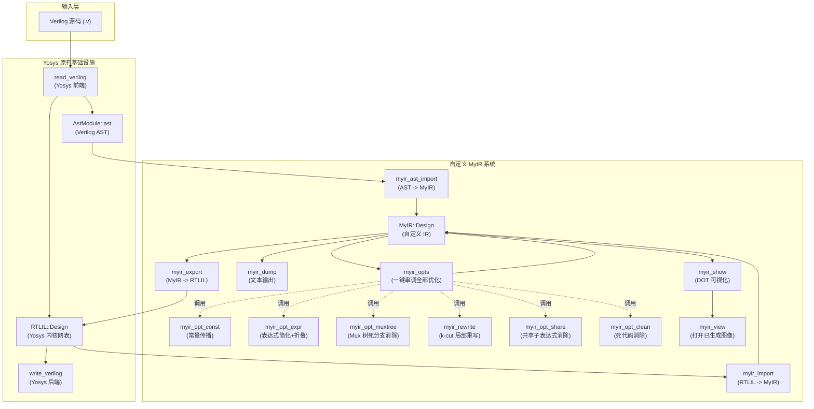

# 基于 Yosys 的自定义中间表示（MyIR）开发项目报告

> 项目路径：`D:\MyVSYosys-pub\yosys\passes\myir\`
> 参考原型：`D:\VerilogCompiler\`（学长独立工具）
> 日期：2026 年 4 月

---

## 一、项目背景与目标

### 1.1 项目起源

本项目起源于一个 Verilog 编译器课程设计。项目最初基于学长开发的独立工具 **VerilogCompiler**（`d:\VerilogCompiler\main`），该工具通过自定义的词法/语法分析生成中间数据结构 `MyMidModuleMap`，并在其上实现了共享子表达式消除（`optShareIR`）、死代码消除（`optClean`）和 DOT 网表可视化（`My_show_netlist`）等功能。

后续老师提出新要求：**不另做独立软件，而是在开源综合工具 Yosys 内部注册自定义 Pass**，让用户在 Yosys 交互式 shell 中就能调用自定义功能。这要求我们深入理解 Yosys 的 RTLIL 内核架构和 AST 前端，并设计一套与 Yosys 生态深度集成的自定义 IR 系统。

### 1.2 核心目标

1. **设计一套自定义中间表示（MyIR）**，比 Yosys 的 RTLIL 更高层、更可读，支持显式类型、扁平表达式列表、以及过程语句结构
2. **提供两条 IR 构建路线**：从 RTLIL 网表转换（`myir_import`）和从 Verilog AST 直接转换（`myir_ast_import`）
3. **在 MyIR 上实现多层优化**：共享子表达式消除、死代码消除、常量传播、表达式简化与折叠、Mux 树死分支消除、k-cut 局部代数重写；并提供 `myir_opts` 一键流水线入口
4. **提供可视化与输出能力**：人类可读的文本格式（`myir_dump`）和 Graphviz DOT 图（`myir_show` + `myir_view`）
5. **支持 IR 回写**：将优化后的 MyIR 导出回 RTLIL（`myir_export`），继续走 Yosys 原有后端流程
6. **零侵入集成**：不修改 Yosys 任何原有源文件，所有代码以 Yosys Pass 形式存在

---

## 二、系统架构

### 2.1 整体数据流



### 2.2 两条导入路线对比

| 特性 | `myir_import`（RTLIL 路线） | `myir_ast_import`（AST 路线） |
|------|---------------------------|------------------------------|
| 数据来源 | `RTLIL::Cell` / `Wire` / `Connection` | `AST::AstNode` 表达式树 |
| 表达式形态 | 已被 Yosys 展平为独立 cell | 保留原始嵌套树结构，由我们展平 |
| 过程块支持 | 不支持（RTLIL 中 always 已被 elaborate） | 支持 `if/else`、`case`、阻塞/非阻塞赋值 |
| AST 层级信息 | 丢失 | 保留 |
| 适用场景 | 已经过 `proc` 等 Pass 处理的设计 | `read_verilog` 后直接使用 |

---

## 三、MyIR 数据结构设计

### 3.1 核心类型层次

```
MyIR::Design
  └── modules : map<string, Module>
        └── Module
              ├── name       : string
              ├── ports      : vector<Port>       — 有序端口列表
              ├── wires      : map<string, Port>  — 所有线网（含端口和内部线）
              ├── exprs      : vector<Expr>       — 运算表达式（对应 RTLIL Cell）
              ├── connects   : vector<Assign>     — 直连赋值
              └── proc_blocks: vector<ProcBlock>  — 过程块（来自 AST 路线）
```

### 3.2 关键类型定义

| 类型 | 说明 |
|------|------|
| `Port` | 线网描述：名称、方向（Input/Output/InOut/Internal）、位宽、有无符号 |
| `OpType` | 运算类型枚举，覆盖 28 种操作：位运算、算术、比较、移位、归约、逻辑、Mux 等 |
| `Expr` | 一条运算：操作类型 + 操作数 wire 名列表 + 结果 wire 名 + 结果位宽 |
| `Assign` | 直连赋值：LHS wire = RHS wire |
| `ProcBlock` | 过程块（简化的 always 块，不建模敏感列表） |
| `Statement` | 过程语句：赋值 / if-else / case / block，支持嵌套 |

### 3.3 与 RTLIL 的关键区别

- **显式类型**：每个 wire 有 `width` + `is_signed`，每个运算有 `OpType` 枚举
- **高可读性**：扁平的 `Expr` 列表，而非 RTLIL 的 `Cell` + `IdString` + `dict<SigSpec>`
- **不依赖 Yosys 注册机制**：`MyIR::Design` 是纯 C++ 数据结构，可独立使用
- **易于扩展**：新增优化只需遍历 `exprs` 向量
- **过程结构保留**：通过 AST 路线可保留 if/else、case 等高层语义

---

## 四、已完成的开发内容

### 4.1 文件清单

所有自定义代码位于 `D:\MyVSYosys-pub\yosys\passes\myir\`，共 15 个源文件 + 15 个测试文件：

| 文件 | 角色 | 行数（约） |
|------|------|-----------|
| `myir.h` | MyIR 数据结构定义 + 全局 Design 指针声明 + 可视化与评分辅助函数 | 150 |
| `myir.cc` | 辅助函数：OpType 映射、常量工具、Statement 工具、Graphviz 查找、benefit 评分 | 350 |
| `myir_import.cc` | Pass `myir_import`：RTLIL -> MyIR | 155 |
| `myir_ast_import.cc` | Pass `myir_ast_import`：Verilog AST -> MyIR | 330 |
| `myir_export.cc` | Pass `myir_export`：MyIR -> RTLIL | 165 |
| `myir_dump.cc` | Pass `myir_dump`：MyIR 文本格式输出 | 170 |
| `myir_show.cc` | Pass `myir_show`：DOT 可视化 + 按需弹窗 | 320 |
| `myir_view.cc` | Pass `myir_view`：打开已生成的图像/DOT 文件 | 80 |
| `myir_opt_share.cc` | Pass `myir_opt_share`：共享子表达式消除 | 95 |
| `myir_opt_clean.cc` | Pass `myir_opt_clean`：死代码消除 | 100 |
| `myir_opt_const.cc` | Pass `myir_opt_const`：常量传播（含穿透 Buf/Pos） | ~155 |
| `myir_opt_muxtree.cc` | Pass `myir_opt_muxtree`：Mux 树死分支消除（路径条件分析） | ~430 |
| `myir_opt_expr.cc` | Pass `myir_opt_expr`：表达式简化 + 常量折叠（28+ 运算 + 互反/幂等规则） | ~410 |
| `myir_rewrite.cc` | Pass `myir_rewrite`：k-cut 局部代数重写（8 大类规则 + max-cuts/stats） | ~1240 |
| `myir_opts.cc` | Pass `myir_opts`：一键串调所有 MyIR 优化（含 fixpoint 迭代） | ~170 |

| 测试文件 | 用途 |
|----------|------|
| `tests/carry.v` | 简单组合逻辑进位模块 |
| `tests/share_test.v` | 共享子表达式测试 |
| `tests/mux_ifelse.v` | if/else 过程块测试 |
| `tests/mux_case.v` | case 语句测试 |
| `tests/const_test.v` | 常量传播 / 折叠测试 |
| `tests/muxtree_test.v` | Mux 树死分支与同输入合并测试 |
| `tests/expr_test.v` | 表达式简化 / 互反 / 折叠测试 |
| `tests/rewrite_test.v` | k-cut 重写 + 三条互反规则（sub_self / or_comp / and_comp） |
| `tests/test_e2e.ys` | RTLIL 路线端到端测试脚本 |
| `tests/test_ast.ys` | AST 路线端到端测试脚本（含对比） |
| `tests/test_const.ys` | 常量传播专项测试 |
| `tests/test_muxtree.ys` | Mux 树优化专项测试 |
| `tests/test_expr.ys` | 表达式简化专项测试 |
| `tests/test_rewrite.ys` | k-cut 重写专项测试 |
| `tests/test_all_opts.ys` | 全流水线一键脚本：`myir_opts -fixpoint -stats -k 4` 与手工串调对照 |

### 4.2 各 Pass 功能详述

#### myir_import — RTLIL 到 MyIR 转换

- 遍历 `design->selected_modules()` 中的每个 RTLIL 模块
- 将 `RTLIL::Wire` 映射为 `MyIR::Port`（提取 name/width/port_input/port_output/is_signed）
- 将 `RTLIL::Cell`（如 `$and`、`$or`）映射为 `MyIR::Expr`（提取 `\A`/`\B`/`\Y` 端口为 operands/result_wire）
- 将 `RTLIL::SigSig` connections 映射为 `MyIR::Assign`
- 支持 `SigSpec` 到 wire 名和常量字面量的转换

#### myir_ast_import — Verilog AST 到 MyIR 转换

- 通过 `dynamic_cast<AST::AstModule*>(module)->ast` 获取 pre-simplify AST 克隆
- **表达式树展平算法**：递归遍历 AST 表达式节点（`AST_BIT_AND`、`AST_ADD`、`AST_TERNARY` 等），为每个中间结果生成临时 wire（`$ast_tN`），构建扁平 `Expr` 列表；最后一个表达式直接写入 LHS wire 避免冗余
- **过程语句提取**：递归解析 `AST_ALWAYS` 内的 `AST_BLOCK`、`AST_CASE`（Yosys 中 if/else 表示为 AST_CASE + AST_COND）、`AST_ASSIGN_EQ`/`AST_ASSIGN_LE`，生成 `Statement` 树
- **Wire 宽度推断**：从 `AST_WIRE` 的 `AST_RANGE` 子节点提取常量边界计算位宽

#### myir_export — MyIR 到 RTLIL 导出

- 从 MyIR 重建 RTLIL 模块：`addModule()` / `addWire()` / `addCell()` / `connect()`
- 将 `MyIR::OpType` 映射回 `$and`/`$or` 等 cell type
- 正确设置 cell 参数（`A_WIDTH`/`B_WIDTH`/`Y_WIDTH`/`A_SIGNED`/`B_SIGNED`）
- 对含过程块的模块输出 warning（过程块暂不导出到 RTLIL）

#### myir_dump — 文本格式输出

输出示例：
```
module carry
  port input  a : 1 bit
  port input  b : 1 bit
  port output cout : 1 bit
  wire   x : 1 bit

  expr And  $0 = a, b  -> x : 1 bit
  expr Or   $1 = x, c  -> cout : 1 bit

  proc_block 0
    if (sel)
      assign y = b
    else
      assign y = a
  end
end
```

#### myir_show — DOT 可视化

- 输入端口用浅蓝色八角形、输出端口用浅黄色八角形
- 表达式节点用圆角方框、常量用菱形
- 过程块用虚线子图（`subgraph cluster_proc_N`），if/else 用菱形节点，case 用梯形节点
- 自动调用 Graphviz `dot` 生成 PNG/PDF/SVG
- Graphviz 查找顺序（A+B 策略）：
  1. 从 `<exe_dir>` 开始，向上最多 3 级目录，依次检查 `tools/graphviz/bin/dot(.exe)`
     （覆盖 VS 构建输出 `MyVSYosys/x64/Debug/` 等，能一直找到仓库根 `tools/graphviz/`）
  2. `MYIR_DOT` 环境变量
  3. 系统 `PATH`
- 命令行参数：
  - `-o <file>` 指定 .dot 输出路径（默认 `myir_show.dot`）
  - `-fmt <format>` 图像格式 `png|pdf|svg`（默认 `png`）
  - `-view` 生成后用系统默认看图工具打开（非阻塞）
  - `-viewer <cmd>` 生成后用指定命令打开（优先于 `-view`）
  - `-no-image` 只写 `.dot`，不调用 `dot`（Graphviz 缺失时也不报错）
- 默认**不**弹窗；日志会提示 `Use -view to open or run 'myir_view <file>' later.`

#### myir_view — 打开已生成的图像/DOT 文件

- 与 `myir_show` 分工：`myir_show` 只负责生成，`myir_view` 只负责打开，不重跑 Graphviz
- 典型用法：
  ```
  yosys> myir_show                 # 第一次只生成文件
  yosys> ...                       # 继续其他操作
  yosys> myir_view myir_show.png   # 之后随时打开，不重新生成
  ```
- 参数：
  - `<file>` 必选；缺失时 `log_error` 并给出 Usage 提示
  - `-viewer <cmd>` 用指定程序打开（默认走系统关联）
- 文件不存在时 `log_error`；支持传入任意路径，也能用于打开 `.dot`、Yosys 原生 `show` 产出的图片等

#### myir_opt_share — 共享子表达式消除

- 以 `(op, operands)` 为 key 构建哈希表
- 遇到重复表达式时，将后续引用全部重写为第一次出现的 `result_wire`
- 删除冗余 Expr，保留唯一实例

#### myir_opt_clean — 死代码消除

- 收集所有被引用的 wire（来自表达式 operands、连接、输出端口）
- 删除 `result_wire` 未被引用的表达式
- 迭代执行直到不再有变化（处理级联死代码）
- 同时清除不再被引用的内部 wire

#### myir_opt_const — 常量传播（链式 + 穿透 Buf/Pos）

`myir_opt_const` 在 2025 年的拆分后专注于**纯常量传播**，把原本耦合在一起的常量折叠职责整体迁出到 `myir_opt_expr`。

- **链式传播**：用 `build_known_constants` 反复扫描，把已知为常量的 wire 通过 `connects` 链以及单输入 `Buf/Pos` 表达式继续向下传播
- **穿透 Buf/Pos**：之前形如 `assign y = x` 但走的是 `Buf/Pos` 表达式而非 `connect` 的路径会被遗漏，现在统一在 `build_known_constants` 内处理
- **替换两类用点**：(1) 表达式的 operand；(2) connect 的 RHS
- **不再做折叠**：避免与 `myir_opt_expr` 的 28+ 运算编译期求值重复
- **汇总日志**：每次执行结束打印 modules visited / known-constant wires（含 Buf/Pos 派生数）/ operand replacements / connect rewrites / total substitutions

#### myir_opt_muxtree — Mux 树死分支消除

新加入的优化命令，专注于 **多路选择器树（Mux Tree）的化简**，互补于 `myir_opt_expr` 的局部规则。

- **三类规则**：
  - `same_inputs`：`mux(s, x, x)` → `x`
  - `const_sel`：select 信号在当前路径上可推断为常量，直接选择对应分支
  - `path_cond`：基于路径条件分析，识别从根节点开始永远走不到的分支
- **`find_root_muxes`**：从 module 输出端口 / 非 Mux 用户向上找到根 Mux 列表，避免反复访问中间节点
- **路径条件传播**：通过 `add_known_value` 记录每条路径上 select 信号的已知取值；可推断 `Not(s)`、`Buf(s)`、`Pos(s)` 等单输入派生表达式的取值
- **Connect 透传**：在路径分析时穿透 connect / Buf / Pos，避免被这些"中转"节点截断
- **benefit_score 现为 advisory**：所有 mux 简化都视为有利，分数只用于日志输出
- **汇总日志**：root muxes discovered / mux-tree visits / branches removed（按 same_inputs / const_sel / path_cond 分类）/ muxes collapsed

#### myir_opt_expr — 表达式简化与常量折叠

新加入的优化命令，承接原 `myir_opt_const` 拆出来的折叠职责，并扩充了一批代数规则。

- **完全常量折叠**：当一条表达式所有 operand 都为常量时直接编译期求值。`eval_expr` 现已覆盖 28+ 运算：
  - 位/逻辑：`And/Or/Xor/Xnor/Not/Logic_*`
  - 比较：`Eq/Ne/Lt/Le/Gt/Ge`
  - 算术：`Add/Sub/Mul/Neg`
  - 移位：`Shl/Shr/Sshl/Sshr`（`Sshr` 暂保持无符号语义，与拆分前一致，留有 TODO）
  - 归约：`Reduce_And/Reduce_Or/Reduce_Xor/Reduce_Xnor/Reduce_Bool`
  - 单元：`Buf/Pos`，多路：`Mux`
- **部分常量折叠 / 门退化**：例如 `x & 0` → `0`、`x | 1...1` → `1...1`、`x * 1` → `x`、`x * 0` → `0`、`mux(0, a, b)`→`a`、`mux(1'b1, 1'b0, b)`→`~s`（rewrite 为 `Not`）等
- **互反规则**（新增，需要 `module + producer` 上下文判断 `Not(x)`）：
  - `sub_self`：`a - a` → `0`
  - `or_complement`：`x | ~x` → 全 1
  - `and_complement`：`x & ~x` → `0`
- **幂等规则**：`x & x` → `x`、`x | x` → `x`、`x ^ x` → `0`
- **打分挑选**：所有匹配的候选规则统一通过 `transform_benefit_score` 评分，保留得分最高者
- **汇总日志**：total simplifications + 按规则名分组的 `rule_hits`

> 建议组合使用顺序：`myir_opt_const → myir_opt_expr`，让常量先通过传播尽量靠近表达式后再折叠。`myir_opts` 已经按这个次序自动安排。

#### myir_rewrite — k-cut 局部代数重写

最重型的优化命令，针对的是 `myir_opt_expr` 单点规则无法覆盖的、跨 2–3 个 cell 的局部模式。

- **k-cut 枚举**：递归对每个 expression 节点列出叶子数 ≤ k（默认 4）的所有局部子图（`enumerate_cuts_rec`），并 memoize
- **`-max-cuts <N>` 限额**（默认 16）：对每个节点保留的 cut 数封顶，按"叶子少优先 / 内部节点少优先"截断，避免组合爆炸；命中截断时在 summary 打印 `cuts truncated by -max-cuts`
- **8 大类重写规则**：
  | 类别 | 模式（节选） |
  |---|---|
  | distributive_factor | `(a & b) \| (a & c)` → `a & (b \| c)` 等 |
  | absorption | `x \| (x & y)` → `x` 等 |
  | idempotent | `x & x` → `x`、`x \| x` → `x` |
  | xor_self / xnor_self | `x ^ x` → `0`、`x ~^ x` → `1` |
  | double_not | `~~x` → `x` |
  | demorgan | `~a \| ~b` → `~(a & b)` 等 |
  | consensus / resub | `(x & y) \| (~x & y)` → `y` 等 |
  | const | `x & 0` / `x \| 1` / `x ^ 0` 等 |
- **benefit_score 评分**：在多条规则都匹配的同一 cut 上取得分最高者，避免劣化重写
- **CLI 参数**：`-k <N>` / `-max-cuts <N>` / `-stats`
- **汇总日志**：iterations / total cuts enumerated / peak per node / rewrites applied；加 `-stats` 后还会按 rule_name 分组输出命中明细
- **澄清**：本 pass 与 Yosys 自带的 ABC 工艺映射（`abc` / `techmap`）不是一回事——`myir_rewrite` 仍在 MyIR 这一中间表示上工作，**不接触工艺库**

#### myir_opts — 一键串调所有 MyIR 优化

仿 Yosys 自带 `opt` pass 设计的"集中入口"，内部用 `Pass::call(design, "...")` 顺次调用 MyIR 的全部优化 pass。

- **默认调用链**：
  ```
  myir_opt_const → myir_opt_expr → myir_opt_const → myir_opt_muxtree
  → myir_opt_expr → myir_rewrite → myir_opt_share → myir_opt_clean
  ```
  其中 `opt_const` 出现两次：第一次清掉显式常量，第二次回收折叠产生的新常量。
- **CLI 参数**：
  - `-once`（默认）：只跑一轮
  - `-fixpoint`：反复跑直到 MyIR 不再变化（用每模块 `exprs.size() + connects.size() + wires.size()` 的指纹做收敛判定），上限 10 轮
  - `-k N`：透传给 `myir_rewrite -k N`
  - `-stats`：透传给 `myir_rewrite -stats`
  - `-noconst / -noexpr / -nomuxtree / -norewrite / -noshare / -noclean`：跳过对应子 pass
- **日志**：每一轮前 `log_header(...round %d...)`，结束时打印 `converged after N round(s)` 或 `stopped after N round(s) (max_rounds reached)`
- **使用建议**：日常开发首选 `myir_opts`，单 pass 留给调试 / 教学演示 / 性能对比

### 4.3 工程集成

- `MyVSYosys.vcxproj` 中包含全部 15 个 MyIR `<ClCompile>` 条目和 1 个 `<ClInclude>` 条目
- `MyVSYosys.vcxproj.filters` 同步更新到"源文件"分组
- **Yosys 原有文件零修改**

---

## 五、与 VerilogCompiler 原型的关系

| 维度 | VerilogCompiler（原型） | MyIR（本项目） |
|------|------------------------|---------------|
| 定位 | 独立工具，自带词法/语法分析 | Yosys Pass，复用 Yosys 前端/后端 |
| 数据结构 | `MyMidModuleMap` / `PGate` / `PExpr` 树 | `MyIR::Design` / `Expr` 列表 / `Statement` 树 |
| 共享子式消除 | `optShareIR` — 基于 gate 字符串 key | `myir_opt_share` — 基于 `(OpType, operands)` key |
| 死代码消除 | `optClean` — 基于 `MIDDLE` wire 类型 | `myir_opt_clean` — 基于引用计数迭代 |
| 常量传播 | `optConstProp` — 占位未实现 | `myir_opt_const` — 完整实现，支持 28 种运算的编译期求值 |
| DOT 可视化 | `My_show_netlist` — 后序遍历 PExpr 树 | `myir_show` — 从扁平 Expr + ProcBlock 生成，含子图 |
| AST 支持 | 无 | `myir_ast_import` — 直接从 Yosys AST 构建 |

---

## 六、使用演示

### 6.1 RTLIL 路线（组合逻辑）

```
yosys> read_verilog carry.v
yosys> myir_import
yosys> myir_dump
yosys> myir_opt_share
yosys> myir_opt_const
yosys> myir_opt_clean
yosys> myir_show -o carry.dot -fmt png         # 仅生成
yosys> myir_view carry.png                     # 之后按需查看
yosys> myir_export
yosys> write_verilog carry_out.v
```

### 6.2 AST 路线（含过程块）

```
yosys> read_verilog mux_ifelse.v
yosys> myir_ast_import
yosys> myir_dump
yosys> myir_show -o mux.dot -fmt png -view     # 生成并立即弹窗
```

### 6.3 Graphviz 预备步骤（任选其一）

1. 安装 Graphviz 并把 `bin` 加入 `PATH`（官网：<https://graphviz.org/download/>）
2. 把 Graphviz 便携版解压到仓库根下 `tools/graphviz/`，使得 `tools/graphviz/bin/dot.exe` 存在
3. 设置环境变量 `MYIR_DOT` 指向 `dot.exe` 的完整路径

### 6.4 全优化流水线（推荐用法）

日常开发只用一条命令 `myir_opts` 就能跑完所有 MyIR 优化：

```
yosys> read_verilog passes/myir/tests/rewrite_test.v
yosys> myir_import
yosys> myir_opts -fixpoint -stats -k 4
yosys> myir_export
yosys> write_verilog out.v
```

`-fixpoint` 让流水线反复迭代到 MyIR 不再变化（上限 10 轮），`-stats` 透传给 `myir_rewrite` 让其输出每条规则的命中明细，`-k 4` 设定 k-cut 上限。`myir_opts -once -noshare -noclean` 这种组合则适合在调试单条规则时只跑前半段。

### 6.5 等价的手工串调（用于调试 / 对比）

`tests/test_all_opts.ys` 同时演示了 `myir_opts` 和手工串调两种用法，便于将两者输出做 diff 验证：

```
myir_opt_const
myir_opt_expr
myir_opt_const
myir_opt_muxtree
myir_opt_expr
myir_rewrite -k 4 -stats
myir_opt_share
myir_opt_clean
```

---

## 七、待完成事项

### 7.1 编译验证

目前所有代码已编写完成但尚未在 Visual Studio 2022 中实际编译。需要：

- [ ] 打开 `D:\MyVSYosys-pub\MyVSYosys.sln`，执行 Build
- [ ] 修复可能出现的编译错误（头文件路径、API 兼容性等）
- [ ] 验证 `yosys> help` 中出现所有 `myir_*` 命令

### 7.2 端到端测试

- [ ] 用 `carry.v` 执行 `test_e2e.ys` 完整流程
- [ ] 用 `mux_ifelse.v` 和 `mux_case.v` 执行 `test_ast.ys`
- [ ] 对比 `myir_import` 与 `myir_ast_import` 在 `carry.v` 上的输出差异
- [ ] 验证 `myir_export` + `write_verilog` 产出的 Verilog 功能正确

### 7.3 优化效果验证

- [ ] 用 `share_test.v` 验证 `myir_opt_share` 确实消除了重复表达式
- [ ] 构造含常量运算的测试设计，验证 `myir_opt_const` 的折叠效果
- [ ] 验证 `myir_opt_clean` 在优化后正确清除死代码

---

## 八、可进一步拓展与优化的方向

### 8.1 IR 层面

| 方向 | 说明 | 难度 |
|------|------|------|
| **AST_CONCAT / 位选支持** | 当前 `myir_ast_import` 对 `AST_CONCAT` 和位选（`wire[3:0]`）的处理较简化，可完善为真正的拼接/切片表达式 | 中 |
| **多模块层次化** | 支持 `AST_CELL`（模块实例化），将子模块引用记录在 MyIR 中，实现层次化 IR 表示 | 中 |
| **时序逻辑建模** | 在 `ProcBlock` 中添加敏感列表（posedge clk 等），支持寄存器和触发器的 IR 表示 | 高 |
| **MyIR 文本格式反向解析** | 实现 `myir_read` Pass，从 `.myir` 文本文件读回 `MyIR::Design`，实现完整的序列化/反序列化 | 中 |

### 8.2 优化 Pass

| 方向 | 说明 | 难度 |
|------|------|------|
| **运算强度削减** (部分完成) | `myir_opt_expr` 已覆盖 `x*1/x*0/x+0/x-x` 等代数简化与互反规则；仍可进一步引入 `x*2^k`→`x<<k`、`x/2^k`→`x>>k` 等需要常量分析的子集 | 低 |
| **冗余 Mux 消除** (已完成) | `myir_opt_muxtree` 全面覆盖 `mux(s,a,a) / mux(const,a,b)` 以及基于路径条件分析的死分支识别 | — |
| **优化统计报告** (已完成) | `opt_const / opt_expr / opt_muxtree / rewrite` 全部具备汇总日志；`rewrite -stats` 还能输出按规则分组的命中明细 | — |
| **集中优化入口** (已完成) | `myir_opts` 一键串调全部 MyIR 优化并支持 `-fixpoint` 收敛迭代 | — |
| **k-cut 限额与统计** (已完成) | `myir_rewrite -max-cuts N` 控制每个节点的 cut 数；`-stats` 输出规则命中明细 | — |
| **公共前缀/后缀提取** | 在 case 语句的多个分支中提取公共赋值 | 中 |
| **过程块内的优化** | 将现有优化（share/const/clean）扩展到 `proc_blocks` 内部的表达式 | 中 |
| **Sshr 真正的符号扩展** | 当前 `myir_opt_expr` 的 `Sshr` 仍按无符号 `>>` 折叠（与拆分前一致），需要补回 sign-extend 语义 | 低 |

### 8.3 可视化

| 方向 | 说明 | 难度 |
|------|------|------|
| **优化前后对比图** | 同时生成优化前/后的 DOT，高亮被消除/修改的节点 | 中 |
| **交互式 HTML 输出** | 使用 D3.js 或 Mermaid 生成交互式网页，支持缩放、节点高亮 | 中 |
| **层次化子图** | 为多模块设计生成分层 DOT 图，每个模块一个子图 | 低 |
| **按需弹窗 / 独立查看命令** (已完成) | `myir_show -view` 一步到位；`myir_view <file>` 打开已生成图像不重跑 Graphviz；Graphviz 支持便携版 + PATH 两种定位 | — |

### 8.4 工程质量

| 方向 | 说明 | 难度 |
|------|------|------|
| **单元测试框架** | 为每个优化 Pass 编写自动化测试（输入 IR → 运行优化 → 验证输出 IR） | 中 |
| **RTLIL 等价性验证** | 优化前后的 RTLIL 通过 Yosys 的 `equiv_*` Pass 做形式验证 | 中 |
| **proc_blocks 导出** | 在 `myir_export` 中将过程块转换为 `RTLIL::Process`，实现完整的 AST 路线闭环 | 高 |
| **Yosys 插件化** | 探索将 MyIR Pass 编译为独立 `.dll`，通过 Yosys `plugin` 命令动态加载 | 高 |

---

## 九、项目结构总览

```
D:\MyVSYosys-pub\
├── MyVSYosys\
│   ├── MyVSYosys.sln              ← VS 解决方案
│   ├── MyVSYosys.vcxproj          ← 已添加 MyIR 源文件
│   └── MyVSYosys.vcxproj.filters  ← 已更新
│
├── tools\                         ← 外部工具放置位置（新）
│   └── graphviz\                  ← 可选的 Graphviz 便携版目录
│       ├── README.md              ← 下载与放置说明
│       └── bin\dot.exe            ← 自行下载后放置
│
└── yosys\
    ├── kernel\                     ← Yosys 内核（不修改）
    ├── frontends\ast\              ← Yosys AST 系统（不修改）
    ├── passes\
    │   ├── opt\                    ← Yosys 原有优化（不修改）
    │   ├── cmds\                   ← Yosys 原有命令（不修改）
    │   └── myir\                   ← ★ 所有自定义代码 ★
    │       ├── myir.h              ← 数据结构定义 + 可视化与评分辅助声明
    │       ├── myir.cc             ← 辅助函数 + Graphviz 查找 + benefit_score
    │       ├── myir_import.cc      ← RTLIL -> MyIR
    │       ├── myir_ast_import.cc  ← AST -> MyIR
    │       ├── myir_export.cc      ← MyIR -> RTLIL
    │       ├── myir_dump.cc        ← 文本输出
    │       ├── myir_show.cc        ← DOT 可视化 + 按需弹窗
    │       ├── myir_view.cc        ← 打开已生成的图像/DOT 文件
    │       ├── myir_opt_share.cc   ← 共享子表达式消除
    │       ├── myir_opt_clean.cc   ← 死代码消除
    │       ├── myir_opt_const.cc   ← 常量传播（含 Buf/Pos 穿透）
    │       ├── myir_opt_muxtree.cc ← Mux 树死分支消除（路径条件）
    │       ├── myir_opt_expr.cc    ← 表达式简化 + 28+ 运算常量折叠
    │       ├── myir_rewrite.cc     ← k-cut 局部代数重写
    │       ├── myir_opts.cc        ← 一键串调所有 MyIR 优化
    │       └── tests\
    │           ├── carry.v
    │           ├── share_test.v
    │           ├── mux_ifelse.v
    │           ├── mux_case.v
    │           ├── const_test.v
    │           ├── muxtree_test.v
    │           ├── expr_test.v
    │           ├── rewrite_test.v
    │           ├── test_e2e.ys
    │           ├── test_share.ys
    │           ├── test_ast.ys
    │           ├── test_const.ys
    │           ├── test_muxtree.ys
    │           ├── test_expr.ys
    │           ├── test_rewrite.ys
    │           └── test_all_opts.ys
    └── ...
```

---

## 十、总结

本项目在 Yosys 开源综合框架内，以零侵入的方式构建了一套完整的自定义中间表示系统 MyIR，涵盖：

1. **双路线 IR 构建**：RTLIL 网表路线和 Verilog AST 路线各有侧重，互为补充
2. **多层优化**：共享子表达式消除、死代码消除、常量传播、表达式简化与折叠、Mux 树死分支消除、k-cut 局部代数重写，并通过 `myir_opts` 一键串调全部优化（含 fixpoint 迭代收敛）
3. **可读输出与可视化**：支持人类可读的文本 dump 和 Graphviz DOT 图形输出，并区分"生成"（`myir_show`）与"打开"（`myir_view`）两步
4. **完整闭环**：Verilog → MyIR → 优化 → RTLIL → Verilog 的端到端流水线
5. **过程结构保留**：AST 路线能提取 if/else、case、阻塞/非阻塞赋值等高层语义
6. **可观测性**：每个优化 pass 输出汇总日志，`myir_rewrite -stats` 还能给出按规则分组的命中明细

项目充分体现了编译器中间表示设计、优化算法实现、以及与成熟开源工具链集成的工程能力。
