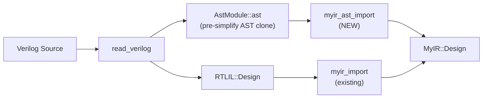

# 基于 AST 的 MyIR 导入开发计划

## 核心思路

Yosys `read_verilog` 后，每个 RTLIL 模块实际上是 `AST::AstModule` 实例，其公有成员 `ast` 持有简化前的 AST 克隆。新 pass 通过 `dynamic_cast` 获取该 AST，递归遍历生成 MyIR。



两条路线并存，用户选择调用 `myir_ast_import` 或 `myir_import`。

---

## 一、扩展 MyIR 数据结构

在 [myir.h](D:\MyVSYosys-pub\yosys\passes\myir\myir.h) 中新增过程块相关类型：

```cpp
// 过程赋值
struct ProcAssign {
    bool        is_blocking;   // true=阻塞(=), false=非阻塞(<=)
    std::string lhs;           // 目标 wire 名
    std::string rhs;           // 源 wire 名（复杂表达式已展平为中间 wire）
};

// If/Else（AST 中 if 表示为 AST_CASE + AST_COND）
struct IfElse {
    std::string condition;                // 条件 wire（复杂条件展平后的结果）
    std::vector<struct Statement> then_body;
    std::vector<struct Statement> else_body;
};

// Case 分支
struct CaseItem {
    std::vector<std::string> values;      // 比较值（空 = default）
    std::vector<struct Statement> body;
};

// Case 语句
struct CaseStmt {
    std::string select;                   // 选择 wire
    std::vector<CaseItem> items;
};

// 统一语句类型
struct Statement {
    enum Kind { Assign, If, Case, Block } kind;
    ProcAssign  proc_assign;              // kind==Assign
    IfElse      if_else;                  // kind==If
    CaseStmt    case_stmt;                // kind==Case
    std::vector<Statement> block_body;    // kind==Block
};

// 过程块（对应 always 块的简化表示，不建模敏感列表）
struct ProcBlock {
    std::vector<Statement> body;
};
```

在 `Module` 中新增字段：

```cpp
struct Module {
    // ... 现有字段保持不变 ...
    std::vector<ProcBlock> proc_blocks;   // NEW
};
```

在 [myir.cc](D:\MyVSYosys-pub\yosys\passes\myir\myir.cc) 中新增：
- AST 节点类型 (`AST_BIT_AND` 等) 到 `OpType` 的映射函数 `ast_type_to_optype()`
- `Statement::Kind` 到字符串的转换

---

## 二、实现 `myir_ast_import` Pass

新文件 `D:\MyVSYosys-pub\yosys\passes\myir\myir_ast_import.cc`，需 `#include "frontends/ast/ast.h"`。

### 2.1 入口逻辑

```cpp
for (auto module : design->selected_modules()) {
    auto *amod = dynamic_cast<AST::AstModule*>(module);
    if (!amod || !amod->ast)
        log_error("Module '%s' has no AST. Run read_verilog first.\n", ...);

    AstNode *mod_ast = amod->ast;   // pre-simplify clone
    // 遍历 mod_ast->children
}
```

### 2.2 模块级 AST 遍历（`mod_ast->children`）

对每个子节点按 `type` 分发：

| AST 节点类型 | 处理方式 |
|---|---|
| `AST_WIRE` | 提取 `str`（名称）、`is_input`/`is_output`、从 `AST_RANGE` 子节点提取 `range_left`/`range_right` 计算 width → `MyIR::Port` |
| `AST_ASSIGN` | `children[0]`=LHS, `children[1]`=RHS → 递归展平表达式树（见 2.3）→ `MyIR::Expr` 列表 |
| `AST_ALWAYS` | 跳过敏感列表子节点（`AST_POSEDGE`/`AST_NEGEDGE`/`AST_EDGE`），找到 `AST_BLOCK` 子节点 → 递归提取语句（见 2.4）→ `MyIR::ProcBlock` |
| `AST_PARAMETER` / `AST_LOCALPARAM` | 若有常量子节点，记录为常量 wire |
| 其他 | `log_warning` 跳过 |

### 2.3 表达式树展平算法

核心递归函数 `std::string flatten_expr(AstNode *node, MyIR::Module &m, int &tmp_cnt)`：

- **`AST_IDENTIFIER`**：返回 `node->str`（wire 名）
- **`AST_CONSTANT`**：将 `node->bits` 转为 `width'bits` 字符串返回
- **二元运算** (`AST_BIT_AND`, `AST_ADD`, `AST_EQ`, ...):
  1. `a = flatten_expr(children[0])` — 递归左操作数
  2. `b = flatten_expr(children[1])` — 递归右操作数
  3. 创建中间 wire `$ast_t<N>`，创建 `Expr{op, [a,b], $ast_t<N>, width}`
  4. 返回 `$ast_t<N>`
- **一元运算** (`AST_BIT_NOT`, `AST_NEG`, `AST_LOGIC_NOT`, `AST_REDUCE_*`):
  1. `a = flatten_expr(children[0])`
  2. 创建 `Expr{op, [a], $ast_t<N>, width}`
  3. 返回 `$ast_t<N>`
- **`AST_TERNARY`**（三元/mux）:
  1. `s = flatten_expr(children[0])` — 条件
  2. `a = flatten_expr(children[1])` — false 值
  3. `b = flatten_expr(children[2])` — true 值
  4. 创建 `Expr{Mux, [a, b, s], $ast_t<N>, width}`
- **`AST_CONCAT`**: 逐个展平子节点，生成拼接信息（或简化为 wire 引用）
- **`AST_RANGE`** (位选): 从 `AST_IDENTIFIER` 的 `children` 中提取范围

对于 `AST_ASSIGN`，最后一个表达式的 `result_wire` 直接设为 LHS wire 名（避免多余中间变量）。

### 2.4 过程语句提取算法

递归函数 `Statement extract_stmt(AstNode *node, MyIR::Module &m, int &tmp_cnt)`：

- **`AST_BLOCK`**: 遍历 children，对每个递归调用，收集为 `Statement{Block, ...}`
- **`AST_ASSIGN_EQ`**: LHS=`flatten_expr(children[0])`, RHS=`flatten_expr(children[1])` → `ProcAssign{blocking=true, lhs, rhs}`
- **`AST_ASSIGN_LE`**: 同上但 `blocking=false`
- **`AST_CASE`** (含 if/else):
  - `children[0]` = 选择/条件表达式 → `flatten_expr` 得到 wire
  - 后续 `AST_COND` 子节点：
    - 若只有 2 个 COND（一个条件 + 一个 DEFAULT）→ 生成 `IfElse`
    - 否则 → 生成 `CaseStmt`，每个 COND 的 `children[0]` 是比较值，其余是 body
- **`AST_FOR`**: 可选处理，提取初始化/条件/步进/body

### 2.5 Wire 宽度推断

由于使用的是 pre-simplify AST，`range_valid` 可能未设置。处理策略：
- `AST_WIRE` 的 `AST_RANGE` 子节点通常有两个 `AST_CONSTANT` children → 直接提取 `bits` 求值得到 left/right
- 中间 wire 宽度：从操作数推断（同 Yosys 的 `detectSignWidth` 逻辑的简化版）
- 对无法推断的情况，默认 width=1

---

## 三、更新 myir_dump / myir_show

### 3.1 myir_dump.cc

在 `dump_module()` 中增加对 `proc_blocks` 的输出：

```
  proc_block
    if (condition_wire)
      assign x = c  [blocking]
    else
      assign x = d  [blocking]
  end
```

### 3.2 myir_show.cc

在 DOT 生成中为 `ProcBlock` 添加子图：
- 用 `subgraph cluster_proc_N` 框住过程块
- If/Else 节点用菱形、Case 节点用梯形
- 过程赋值用箭头连接 wire 节点

---

## 四、Export 兼容性

现有 `myir_export` 基于 `exprs` + `connects` 生成 RTLIL cell/connection。对于 `proc_blocks`：
- 连续赋值部分（已展平到 `exprs`）照常导出
- `proc_blocks` 内容暂不导出到 RTLIL（需要创建 `RTLIL::Process`，复杂度高）
- 在 `myir_export` 中对含 `proc_blocks` 的模块输出 warning 提示

---

## 五、工程集成

在 [MyVSYosys.vcxproj](D:\MyVSYosys-pub\MyVSYosys\MyVSYosys.vcxproj) 的 `ClCompile` 列表中添加：
```xml
<ClCompile Include="..\yosys\passes\myir\myir_ast_import.cc" />
```

---

## 六、测试用例

### 6.1 组合逻辑（验证表达式树展平）
复用现有 `carry.v`:
```
yosys> read_verilog passes/myir/tests/carry.v
yosys> myir_ast_import
yosys> myir_dump
```

### 6.2 If/Else（验证过程语句提取）
新建 `mux_ifelse.v`:
```verilog
module mux2(input a, b, sel, output reg y);
    always @(*) begin
        if (sel) y = b;
        else     y = a;
    end
endmodule
```

### 6.3 Case（验证 case 语句提取）
新建 `mux_case.v`:
```verilog
module mux4(input a, b, c, d, input [1:0] sel, output reg y);
    always @(*) begin
        case (sel)
            2'b00: y = a;
            2'b01: y = b;
            2'b10: y = c;
            2'b11: y = d;
        endcase
    end
endmodule
```

### 6.4 对比验证
同一设计分别用 `myir_import`（RTLIL 路线）和 `myir_ast_import`（AST 路线），对比 `myir_dump` 输出。

---

## 七、使用流程

```
yosys> read_verilog design.v
yosys> myir_ast_import              # AST 路线（新）
yosys> myir_dump                    # 查看 IR（含过程块）
yosys> myir_opt_share               # 优化（作用于 exprs 部分）
yosys> myir_opt_const
yosys> myir_opt_clean
yosys> myir_show -o design.dot      # 可视化
yosys> myir_export                  # 导出（仅 exprs/connects 部分）
yosys> write_verilog design_out.v
```
