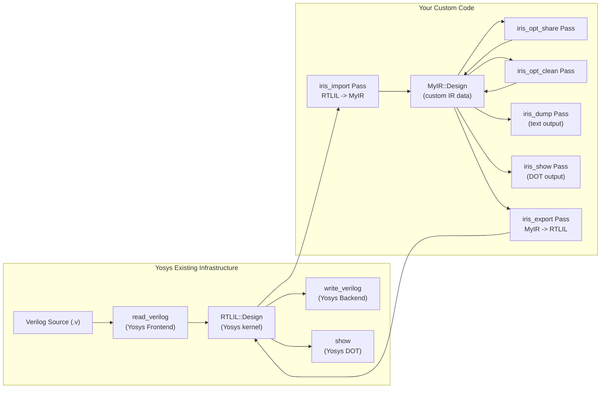
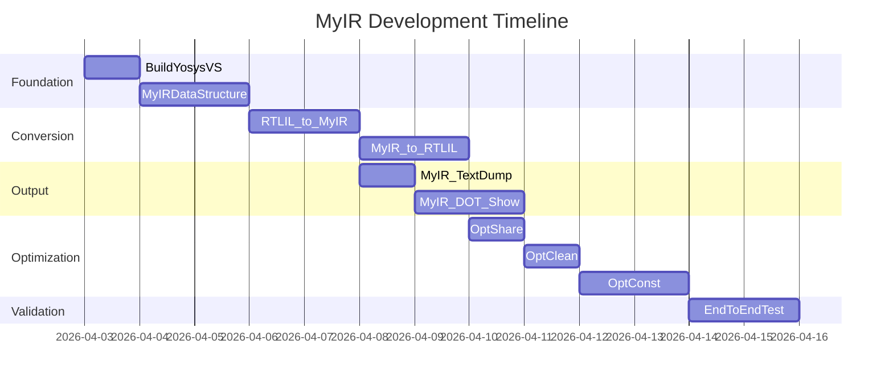

# 基于 Yosys 的自定义 IR 开发计划

## 当前形势

你已经有两个代码库：

- **VerilogCompiler** (`d:\VerilogCompiler\main`) -- 学长的独立工具，任务三四五基本完成
- **IRIS** (`D:\IRIS-pub`) -- 老师下发的 Yosys 源码 Windows 移植版，已可用 VS 2022 编译

老师的新要求核心：**不另做独立软件，而是在 Yosys 内部注册自定义 Pass，用户在 Yosys shell 里就能调用你的功能。**

---

## 架构总览




关键思路：**你的代码全部以 Yosys Pass 的形式存在，不改 Yosys 任何原有文件。** 用户在 Yosys shell 中这样操作：

```
yosys> read_verilog carry.v          # Yosys 原有前端
yosys> iris_import                   # 你的 Pass: RTLIL -> MyIR
yosys> iris_dump output/carry.myir   # 你的 Pass: 输出自定义 IR 文本
yosys> iris_opt_share                # 你的 Pass: 共享子表达式优化
yosys> iris_opt_clean                # 你的 Pass: 死代码消除
yosys> iris_show                     # 你的 Pass: 生成 DOT
yosys> iris_export                   # 你的 Pass: MyIR -> RTLIL
yosys> write_verilog carry_out.v     # Yosys 原有后端
```

---

## 关于 "编译成 DLL" 的建议

团队成员建议把不需要改动的 Yosys 代码编成 DLL -- 这个想法**方向正确但不必那样做**，有更简单的方案：


| 方案                       | 评价                                                                                                              |
| ------------------------ | --------------------------------------------------------------------------------------------------------------- |
| **拆 DLL**                | 理论上可行，但 Yosys kernel 与 Pass 高度耦合（全局 `Design`*、IdString 缓存、日志系统等），拆分工作量巨大且容易出链接问题                                |
| **直接在 Yosys 工程里加文件（推荐）** | 在 VS 工程的 `ClCompile` 列表里新增你自己的 .cc/.h 文件，**Yosys 原有文件一个都不改**。这样既隔离了你的代码，又能直接使用 Yosys 全部 API。编译一次约 2-3 分钟，增量编译很快 |
| **Yosys 插件 (plugin)**    | Yosys 支持 `plugin -i xxx.so` 动态加载 Pass，但在 Windows 上插件机制不完善，不推荐                                                   |


**推荐方案**：在 `D:\IRIS-pub\yosys\` 下新建目录 `passes\myir\`，所有你的文件放在这里。只需修改 `.vcxproj` 把你的文件加入编译列表，Yosys 原有代码零修改。

---

## 阶段一：自定义 IR 数据结构设计（约 2 天）

在 `yosys\passes\myir\` 下新建 `myir.h`，定义与 RTLIL 对标但更高层的 IR 数据结构：

```cpp
namespace MyIR {

enum class PortDir { Input, Output, InOut };

struct Port {
    std::string name;
    PortDir     dir;
    int         width;       // bit width (RTLIL Wire lacks explicit type)
    bool        is_signed;
};

enum class OpType {
    And, Or, Xor, Not,      // bitwise
    Eq, Ne, Lt, Le, Gt, Ge, // comparison
    Add, Sub, Mul,           // arithmetic
    Mux,                     // multiplexer
    Buf,                     // buffer / wire assign
    Unknown
};

struct Expr {
    OpType      op;
    std::string result_wire;  // wire name carrying the result
    int         result_width;
    std::vector<std::string> operands; // input wire names
};

struct Assign {
    std::string lhs;   // destination wire
    std::string rhs;   // source wire (simple connect)
};

struct Module {
    std::string              name;
    std::vector<Port>        ports;        // ordered port list
    std::map<std::string, Port> wires;     // all wires (including ports)
    std::vector<Expr>        exprs;        // operations (= RTLIL Cells)
    std::vector<Assign>      connects;     // direct wire-to-wire connections
};

struct Design {
    std::map<std::string, Module> modules;
};

} // namespace MyIR
```

与 RTLIL 的**关键区别**（即老师要求的设计目标）：

- **显式类型**：每个 wire 有 `width` + `is_signed`，每个运算有 `OpType` 枚举
- **高可读性**：扁平的 `Expr` 列表而非 `Cell` + `IdString` + `dict<SigSpec>`
- **不依赖 Yosys 注册**：`MyIR::Design` 是纯 C++ 数据结构，可以独立 `#include` 使用
- **易于扩展**：新增优化只需遍历 `exprs` 向量

---

## 阶段二：RTLIL -> MyIR 转换 Pass（约 2 天）

新文件：`yosys\passes\myir\iris_import.cc`

注册为 Yosys Pass：

```cpp
struct MyIRImportPass : public Pass {
    MyIRImportPass() : Pass("iris_import",
        "convert RTLIL design to MyIR representation") {}
    void execute(std::vector<std::string> args, RTLIL::Design *design) override;
};
```

核心转换逻辑：

- 遍历 `design->modules_`，对每个 `RTLIL::Module` 建立 `MyIR::Module`
- 遍历 `module->wires_`：将 `RTLIL::Wire` 的 `name` / `width` / `port_input` / `port_output` / `is_signed` 映射到 `MyIR::Port` / `MyIR::Wire`
- 遍历 `module->cells_`：将 `RTLIL::Cell` 的 `type`（如 `$and`、`$or`）映射到 `MyIR::OpType`，将 `connections_` 中的 `\A`/`\B`/`\Y` 端口提取为 `operands` 和 `result_wire`
- 遍历 `module->connections_`：直接映射为 `MyIR::Assign`

转换后的 `MyIR::Design` 存储在全局变量或 design 的 scratchpad 中（Yosys 的 `design->scratchpad` 是 `dict<string,string>`，可存指针地址；或用 C++ 全局 `static MyIR::Design* g_myir`）。

---

## 阶段三：MyIR -> RTLIL 导出 Pass（约 1.5 天）

新文件：`yosys\passes\myir\iris_export.cc`

反向操作：从 `MyIR::Design` 重建 `RTLIL::Module`：

- 用 `design->addModule()` / `module->addWire()` / `module->addCell()` 等 Yosys API
- 将 `MyIR::OpType` 映射回 `$and` / `$or` 等 cell type
- 将 `MyIR::Assign` 映射为 `module->connect()`

---

## 阶段四：MyIR 文本格式输出 Pass（约 1 天）

新文件：`yosys\passes\myir\iris_dump.cc`

输出类似这样的可读文本（与 RTLIL ilang 区分）：

```
# MyIR text format
module carry
  port input  a : 1 bit
  port input  b : 1 bit
  port input  c : 1 bit
  port output cout : 1 bit
  wire x : 1 bit

  expr And  $1 = a, b        -> x     : 1 bit
  expr Or   $2 = x, c        -> cout  : 1 bit
end
```

---

## 阶段五：MyIR 上的优化 Pass（约 2-3 天）

从 VerilogCompiler 中**迁移你已有的优化逻辑**，改为操作 `MyIR::Design`：

`**iris_opt_share`** (`yosys\passes\myir\iris_opt_share.cc`)：

- 遍历 `module.exprs`，将 `(op, operands)` 相同的 Expr 合并
- 后续引用替换为共享的 `result_wire`

`**iris_opt_clean`** (`yosys\passes\myir\iris_opt_clean.cc`)：

- 收集所有被引用的 wire
- 删除 `result_wire` 未被引用的 Expr

`**iris_opt_const`** (`yosys\passes\myir\iris_opt_const.cc`)（扩展）：

- 若操作数都是常量 wire，直接计算结果，替换为常量赋值

---

## 阶段六：MyIR DOT 可视化 Pass（约 1.5 天）

新文件：`yosys\passes\myir\iris_show.cc`

参考 Yosys 原有的 `passes/cmds/show.cc`（`ShowWorker`），但从 `MyIR::Design` 生成 DOT。由于 `MyIR::Expr` 结构比 `RTLIL::Cell` 简单得多，代码量会小很多。同样调用 Graphviz `dot -Tpng` 生成图片（可复用 Yosys 原有的 `DOT_CMD` 逻辑）。

---

## 工程集成方式

只需修改 `[IRIS.vcxproj](D:\IRIS-pub\IRIS\IRIS.vcxproj)` 的 `<ItemGroup>` 部分，添加你的文件：

```xml
<ClCompile Include="..\yosys\passes\myir\myir.cc" />
<ClCompile Include="..\yosys\passes\myir\iris_import.cc" />
<ClCompile Include="..\yosys\passes\myir\iris_export.cc" />
<ClCompile Include="..\yosys\passes\myir\iris_dump.cc" />
<ClCompile Include="..\yosys\passes\myir\iris_show.cc" />
<ClCompile Include="..\yosys\passes\myir\iris_opt_share.cc" />
<ClCompile Include="..\yosys\passes\myir\iris_opt_clean.cc" />
<ClCompile Include="..\yosys\passes\myir\iris_opt_const.cc" />
<ClInclude Include="..\yosys\passes\myir\myir.h" />
```

不需要改 Yosys 任何原有 .cc/.h 文件。编译后运行 `IRIS.exe`，你的 Pass 会自动注册，在 shell 中可直接使用。

---

## 文件清单

所有新文件均在 `D:\IRIS-pub\yosys\passes\myir\` 下：


| File                | Role                              |
| ------------------- | --------------------------------- |
| `myir.h`            | MyIR 数据结构定义 + 全局 Design 指针        |
| `myir.cc`           | MyIR 辅助函数（OpType 名称映射等）           |
| `iris_import.cc`    | Pass `iris_import`: RTLIL -> MyIR |
| `iris_export.cc`    | Pass `iris_export`: MyIR -> RTLIL |
| `iris_dump.cc`      | Pass `iris_dump`: 输出 MyIR 文本格式    |
| `iris_show.cc`      | Pass `iris_show`: 从 MyIR 生成 DOT   |
| `iris_opt_share.cc` | Pass `iris_opt_share`: 共享子表达式优化   |
| `iris_opt_clean.cc` | Pass `iris_opt_clean`: 死代码消除      |
| `iris_opt_const.cc` | Pass `iris_opt_const`: 常量传播       |


---

## 与 VerilogCompiler 的关系

VerilogCompiler (`d:\VerilogCompiler`) 作为**原型/参考实现**保留，不再继续开发。其中的优化算法逻辑（`Optimizer.cpp`）和 DOT 生成逻辑（`Mynetlist.cpp`）可以**参考和迁移**到新的 MyIR Pass 中，但数据结构需要从 `MyMidModuleMap` 换成 `MyIR::Design`。

---

## 实施顺序与时间线




第一步：确保 `D:\IRIS-pub\IRIS.sln` 能在你的 VS 上正常编译并运行 `yosys> help`。